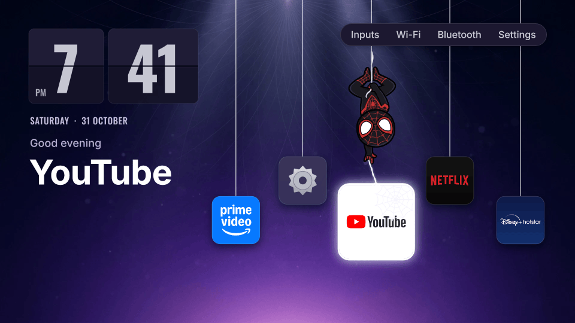
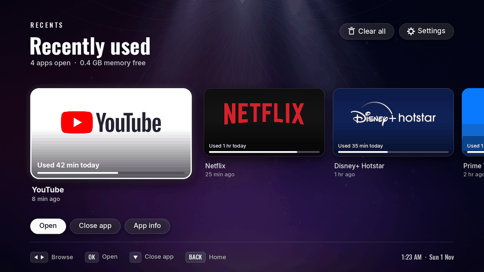

# Spider TV Launcher for Android TV

<p align="center">
  <a href="https://github.com/Fardin7798/Spider-Tv-Launcher/releases/latest"></a>
  <a href="https://github.com/Fardin7798/Spider-Tv-Launcher/releases/latest/download/app-release.apk"></a>
  <a href="LICENSE"></a>
  <a href="https://developer.android.com/about/versions/pie"></a>
  
</p>


An ultra-lightweight, ad-free Android TV launcher with a fan-made Spider theme: a web-swing app carousel, live flip clock, quick controls, a native **Recent Apps Switcher**, and one-click debloat.

> 🕷️ **Fan-made, unofficial tribute.** All artwork, including the hero, is original and made for this project. Not affiliated with, endorsed or sponsored by Marvel or Sony.

---

<p align="center">
  
</p>
<p align="center"><em>Fluid Dynamic Carousel Launcher</em></p>

---

## ✨ Features

- 🕷️ **Fluid Spider Carousel:** Night skyline backdrop with original hanging-hero art on a silk thread, and directional spring physics as you move between apps.
- 🕰️ **Live Flip Clock:** On the home screen, plus a matching **Clock** screensaver.
- 🎛️ **Quick Controls:** A top pill for Inputs, Wi-Fi and Bluetooth (pair remotes and accessories straight from Home).
- 🔄 **Recent Apps Switcher:** Smooth horizontal carousel of running apps with live task switching and quick task controls.
- ⚡ **Zero Volume Lag (Hardware Preservation):** Unlike accessibility-based remappers that break Android's `InputDispatcher` repeat timer, our launcher preserves 100% hardware-speed volume hold acceleration.
- 🎮 **Remote Gesture Shortcuts:** Double-press the Home button from anywhere to immediately bring up the App Switcher.
- 🪶 **Ultra-Lightweight (~450 KB):** Pure Java, zero analytics, zero telemetry, zero background battery drain.
- 🧹 **Safe Debloat Ready:** Compatible with ADB debloat lists to disable manufacturer bloatware (PatchWall, telemetry, recommendation rows) without root.

---

## 📸 Screenshots

| | |
|---|---|
|  |  |
| *Fluid Dynamic Carousel (Directional Focus & Art)* | *Native App Switcher (Double-Press Home)* |
---

## 🚀 1-Click Universal TV Setup

Transform any Android TV or Google TV into an ultra-clean, ad-free experience with automated debloating, SmartTube installation, and the ~450 KB Spider TV Launcher.

### 📋 Prerequisites & Requirements

Before running the setup, ensure:
1. 📶 **Same Wi-Fi Network:** Your computer (laptop/PC) and Android TV must be connected to the exact same Wi-Fi router / network.
2. 📺 **Android TV 9.0+:** Compatible with any TV, box, or stick running Android TV 9, 10, 11, 12, or 14 (Google TV).
3. ⚙️ **Enable USB Debugging on TV:**
   - Go to **Settings ➔ Device Preferences ➔ About**.
   - Scroll down to **Build** and click OK on your remote **7 times** (until you see *"You are now a developer"*).
   - Go back, open **Developer options**, and turn **USB debugging** ON (also turn **Network debugging** ON if present).
4. 💻 **ADB Tool:** Standard Android Platform Tools (`sudo apt install adb` on Linux, `brew install android-platform-tools` on macOS, or pre-bundled in PowerShell for Windows).

---

### 🤖 Option 1: Easiest Setup with Any AI Agent (Recommended for Beginners)

Don't want to deal with terminal commands? You can give this repository to any AI coding assistant (**Claude Code, Cursor, Devin, Antigravity, Roo Code, Windsurf, ChatGPT**):

| Step | Action |
|---|---|
| **1. On your TV** | Settings ➔ Device Preferences ➔ About ➔ Press OK on **Build** 7 times. Back ➔ Developer options ➔ Turn **USB Debugging** ON. |
| **2. In your AI Agent** | Copy and paste [`PROMPT.md`](PROMPT.md) into your assistant chat. |
| **3. Review & Approve** | Your assistant runs a read-only audit (`audit.sh`), shows you the hardware report & plan, and asks for your approval before touching anything! |

---

### 💻 Option 2: Terminal Workflow (For Power Users)

**1. Run Read-Only Audit (Zero changes made to TV):**
```bash
./tools/audit.sh <TV_IP>
```
*Outputs: `reports/report_<ts>.md` (Full audit) and `reports/plan_<ts>.txt` (Editable plan).*

**2. Review & Apply Approved Plan:**
```bash
bash reports/apply_<ts>.sh
```

*(Alternatively, run the interactive 1-click suite directly: `./tools/setup.sh <TV_IP>`)*

**What the automated setup does:**
- 🔍 **Auto-detects TV hardware & manufacturer** (Sony, TCL, Xiaomi, OnePlus, Hisense, Shield, Chromecast).
- 💾 **Creates an instant full-state safety snapshot** of all currently enabled packages, default Home launcher, animation scales, and system settings.
- 🧹 **Safely disables manufacturer bloatware, sponsored recommendation rows, and telemetry** via `pm disable-user`.
- 📺 **Replaces stock ad-heavy YouTube with official SmartTube** (Ad-free, SponsorBlock, TV-optimized).
- 🕷️ **Installs and sets Spider TV Launcher** as the permanent default home activity.

---

### 🛠️ Option 3: Standalone Launcher Installation

If you only want the ultra-lightweight launcher without debloating:
```bash
# 1. Build release APK (or download the latest pre-built APK from GitHub Releases)
./gradlew assembleRelease

# 2. Connect to your TV over Wi-Fi
adb connect <TV_IP>:5555

# 3. Install the launcher
adb install -r app/build/outputs/apk/release/app-release.apk

# 4. Set as permanent default Home launcher
adb shell cmd package set-home-activity --user 0 com.spidertv.launcher/.SpiderHomeActivity

# 5. Grant usage access for Recent Apps Switcher
adb shell appops set com.spidertv.launcher GET_USAGE_STATS allow
```

Then on the TV, open **Settings ➔ Accessibility** and turn on **Home button** (double-press Home for Recents) and **Spider TV Launcher** (remote shortcut keys). Pick **Clock** under Screensaver if you want the flip-clock screensaver.

---

## 🛡️ Multi-Brand Debloat Profiles

Pre-configured, verified debloat profiles are organized in [`profiles/`](profiles/):

| Brand / Platform | Profile File | Target Capabilities Cleaned |
|---|---|---|
| **Xiaomi / Redmi** | [`profiles/xiaomi.txt`](profiles/xiaomi.txt) | PatchWall, Glance lockscreen ads, Mi Video, Mi Music, Mi Analytics |
| **Sony BRAVIA** | [`profiles/sony-bravia.txt`](profiles/sony-bravia.txt) | Samba TV ACR tracking, Sony Select promos, Sony Discover, Demo mode |
| **TCL** | [`profiles/tcl.txt`](profiles/tcl.txt) | TCL Channel, TCL TTVS tracker, TCL Assistant, recommendation feeds |
| **OnePlus TV** | [`profiles/oneplus.txt`](profiles/oneplus.txt) | OxygenPlay, OnePlus Store, HeyTap telemetry, preloaded browser |
| **Hisense** | [`profiles/hisense.txt`](profiles/hisense.txt) | Hisense telemetry, partner ad services, sponsored home rows |
| **NVIDIA SHIELD** | [`profiles/nvidia-shield.txt`](profiles/nvidia-shield.txt) | Shield recommendation rows, telemetry, partner promotions |
| **Chromecast with Google TV** | [`profiles/chromecast-gtv.txt`](profiles/chromecast-gtv.txt) | Google TV sponsored rows, partner auto-installs, feedback sender |
| **Amazon Fire TV** | [`profiles/amazon-fire-tv.txt`](profiles/amazon-fire-tv.txt) | Fire TV sponsored banners, forced promotions, metrics |
| **Universal Fallback** | [`profiles/universal-safe.txt`](profiles/universal-safe.txt) | Safe for any Android TV 9.0+ device |

> [!NOTE]
> **Safety Whitelist:** None of our profiles ever disable Chromecast built-in (`com.google.android.apps.mediashell`), Google Assistant voice search (`com.google.android.katniss`), Wi-Fi/Bluetooth stacks, or Gboard.

---

## ⏪ Instant Rollback & True Full-State Restore

Every modification is 100% reversible. A complete snapshot of your TV's original state (enabled packages, original default Home launcher, animation scales, and system settings) is preserved in `backups/<device>_original/` (Day-1 baseline) and `backups/<device>_<timestamp>/` (per-run).

> [!NOTE]
> **What is restored:** System packages, stock home launcher, animation scales, and system display settings are fully restored. (Private app data directories and saved Wi-Fi credentials cannot be accessed or modified over standard ADB without root access).

To restore your TV back to its exact untouched factory state:
```bash
./tools/restore.sh backups/<device_snapshot_directory>
```
*What the restore engine does:*
- 🔄 Re-enables all original system packages.
- 📺 Restores your original stock launcher as the default Home.
- ⚡ Reverts animation scales back to original values.
- 🕷️ Offers interactive clean uninstallation of Spider TV Launcher and SmartTube.
---

## 🕸️ What's Inside

- 🕷️ Spider night carousel theme with original hanging-hero art, silk thread and live flip clock
- 🔄 Spider Recents task switcher (`RecentAppsActivity`) with 16:9 TV banners
- 🎮 TV Bluetooth remotes & accessories pairing from the top pill
- ⚡ Zero-lag volume hold acceleration
- 🎮 Remote double-press Home gesture
- 🧹 Audit, debloat, backup and full restore scripts with per-brand profiles

## ⚖️ Fan-Made Project & Legal Disclaimer

Spider TV Launcher is an **unofficial, fan-made tribute**: an independent, non-commercial, open-source project for personal TV customization.

- **Original artwork:** All art in this project, including the hero, the night backdrop, the app icon and the TV banner, was made by the author for this project.
- **No affiliation:** This project is not affiliated with, endorsed, sponsored or approved by Marvel Entertainment, LLC, Sony Pictures Entertainment Inc., or any related company. "Spider-Man" and related names and characters are trademarks of their respective owners.
- **Third-party trademarks:** App names and logos shown (such as YouTube, Netflix, Prime Video, Disney+ Hotstar, SmartTube, Google Play / Android) belong to their respective owners.
- Distributed free of charge under the MIT License.

## 📄 License

This project is licensed under the MIT License - see the [LICENSE](LICENSE) file for details.
